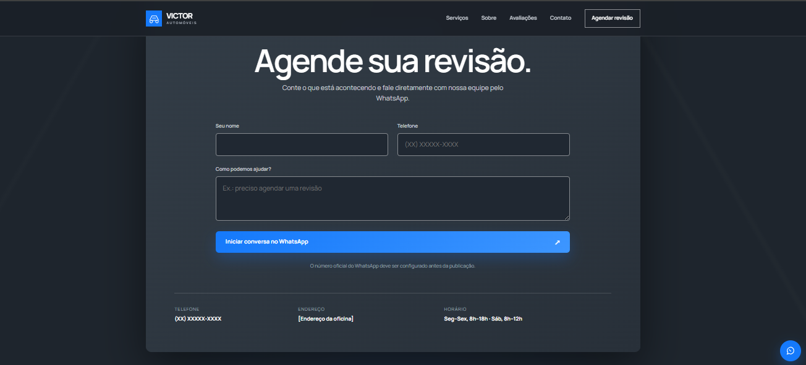

# Victor Automóveis

Landing page demonstrativa para apresentar os serviços de uma oficina mecânica e a experiência de solicitação de orçamento.

**[Acessar o site](https://correavictorhugo.github.io/landing-page-mecanica/)**

## Sobre o projeto

O projeto usa uma identidade visual automotiva com tons de grafite e azul elétrico. A página conduz o visitante pelos serviços, processo de atendimento e uma demonstração interativa do formulário.


<details>
<summary>Ver mais capturas</summary>




</details>

## Funcionalidades

- Layout responsivo para computadores, tablets e celulares
- Menu de navegação adaptado para dispositivos móveis
- Apresentação dos principais serviços da oficina
- Seção explicando o processo de avaliação e autorização do serviço
- Formulário demonstrativo com validação e prévia de mensagem para contato
- Navegação por teclado e foco visível
- Suporte à preferência de redução de movimento

## Tecnologias

- HTML5
- CSS3
- JavaScript
- Google Fonts — Manrope

## Como executar

Clone o repositório:

```bash
git clone https://github.com/CorreaVictorHugo/landing-page-mecanica.git
```

Entre na pasta do projeto:

```bash
cd landing-page-mecanica
```

Abra o arquivo `index.html` no navegador. Se preferir usar um servidor local:

```bash
python -m http.server 8000
```

Depois acesse `http://localhost:8000`.

## Estrutura

```text
landing-page-mecanica/
├── assets/
│   ├── hero-victor-automoveis.png
│   ├── tela-1.png
│   ├── tela-2.png
│   └── tela-3.png
├── index.html
├── style.css
├── script.js
└── README.md
```

## Sobre a demonstração

Este é um projeto de portfólio. Os dados comerciais e avaliações reais não foram fornecidos. O formulário gera uma mensagem no navegador para demonstrar a interação: **nenhum dado é enviado ou armazenado**. Para usar a página com clientes, substitua o conteúdo ilustrativo por informações verificadas e configure um canal oficial de atendimento.

## Autor

Desenvolvido por [Victor Hugo Corrêa](https://github.com/CorreaVictorHugo).

